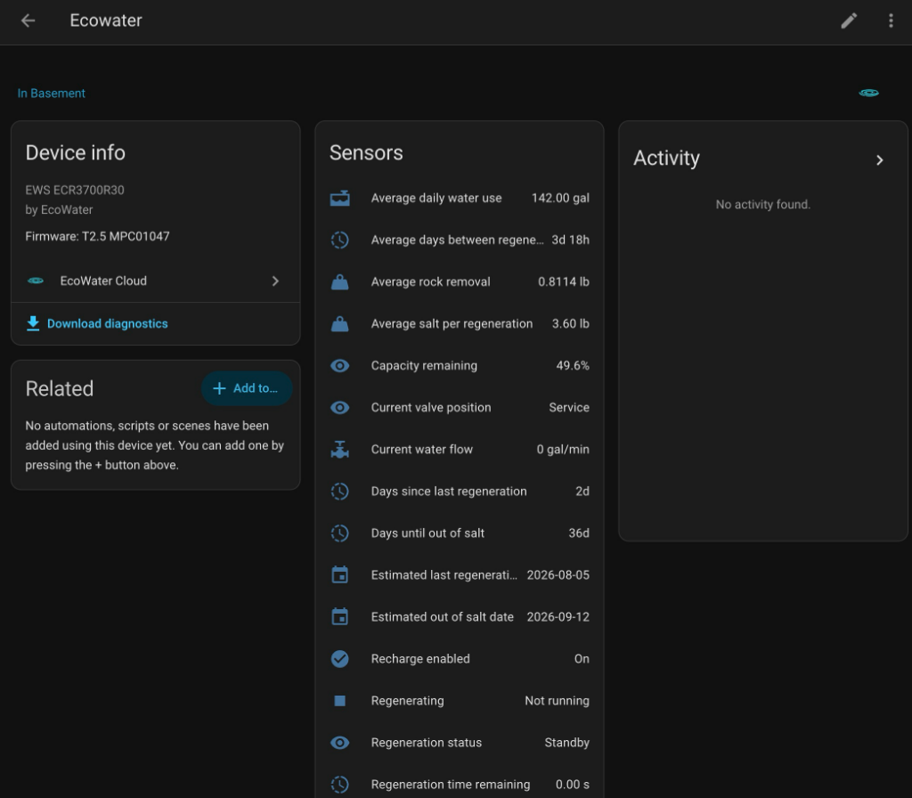

# EcoWater Cloud for Home Assistant

See information from a compatible EcoWater water softener in Home Assistant, including available salt, water usage, and regeneration status.

## What can I do with it?

- Watch available water, water use, salt levels, and estimated days until salt runs out.
- See regeneration status and device connectivity when your device reports them.
- Use [automation blueprints and a dashboard example](docs/automations-and-dashboard.md) for low-salt, flow, stale-data, and regeneration notifications.

Only the capabilities reported by your particular device appear. This integration is **read-only** and cannot start regeneration or control your softener.

## Requirements and compatibility

- Home Assistant **2026.3.0 or newer**, HACS (or the built-in Home Assistant Marketplace in **2026.11+**), an EcoWater Cloud account, and a compatible cloud-connected device.
- The **Ayla** US EWS3500 / EWS ECR3700R30 has been tested. Other Ayla-connected EWS models may work; the EU endpoint is implemented but untested.
- **HydroLink Home devices are not supported.** See [ha-ecowater-hydrolink](https://github.com/Roeli1996/ha-ecowater-hydrolink) for that system.

> [!WARNING]
> Do not run this integration and another integration polling the same EcoWater cloud account at the same time. Excessive polling can cause account lockouts or temporary IP bans.

## Install with HACS or Home Assistant Marketplace

1. Click the **Open your Home Assistant instance** button above (backwards compatible: opens **HACS** on earlier versions and the built-in **Home Assistant Marketplace** on **2026.11+**), or manually add `https://github.com/andrewtryder/ha-ecowater-cloud` as a custom repository in the **Integration** category.
2. Find and download **EcoWater Cloud**.
3. Restart Home Assistant.

For a manual installation, download the [latest release](https://github.com/andrewtryder/ha-ecowater-cloud/releases), copy `custom_components/ecowater_cloud` into your Home Assistant configuration's `custom_components` directory, and restart Home Assistant.

## First-time setup

1. Go to **Settings → Devices & services → Add integration** and select **EcoWater Cloud**.
2. Enter your EcoWater Cloud username or email and password.
3. Submit the form. Devices found on the account appear in Home Assistant.

## What you'll see in Home Assistant

Depending on your model, sensors and binary sensors can show salt level, estimated salt depletion, treated water, flow, regeneration, online status, Wi-Fi signal, and the last cloud update. Raw diagnostic values are not interpreted or scaled. Estimates depend on data from your device and should not replace checking the equipment.

## Common problems and troubleshooting

- **Device unavailable:** check the official EcoWater app and confirm the device is online.
- **Data looks old:** check the `source_last_updated` diagnostic sensor for the last device-to-cloud update.
- **Missing entities:** your device might not report that capability. See [submitting a device fixture](#submitting-a-device-fixture) if you want to help investigate support.
- **Still stuck:** review the diagnostics before sharing them and open a [GitHub issue](https://github.com/andrewtryder/ha-ecowater-cloud/issues). Never post credentials or raw API responses.

## Limitations, safety, and privacy

The integration polls the EcoWater Ayla cloud over HTTPS and stores credentials through Home Assistant. It does not send telemetry or personal data to the integration developer. When moving from another integration, existing entities do not transfer automatically: this integration uses a separate domain and creates new entities. Review automations and dashboards after migration.

## Submitting a device fixture

Contributors can use the probe described in [CONTRIBUTING.md](CONTRIBUTING.md#submitting-device-fixtures) to collect a fixture from their own account. It makes real cloud requests. Review the generated file for personal data before sharing it; never publish credentials, tokens, or raw responses.

## More documentation

- [Automations and dashboard example](docs/automations-and-dashboard.md)
- [Development guide](DEVELOPMENT.md) and [contributing](CONTRIBUTING.md)
- [Architecture](docs/architecture.md) and [protocol notes](docs/protocol-ayla.md)
- [Third-party notices](THIRD_PARTY_NOTICES.md) and [security policy](SECURITY.md)

## Support and license

Report reproducible issues on [GitHub](https://github.com/andrewtryder/ha-ecowater-cloud/issues). This community project is not an official EcoWater product. See the [MIT license](LICENSE) and [third-party notices](THIRD_PARTY_NOTICES.md).
